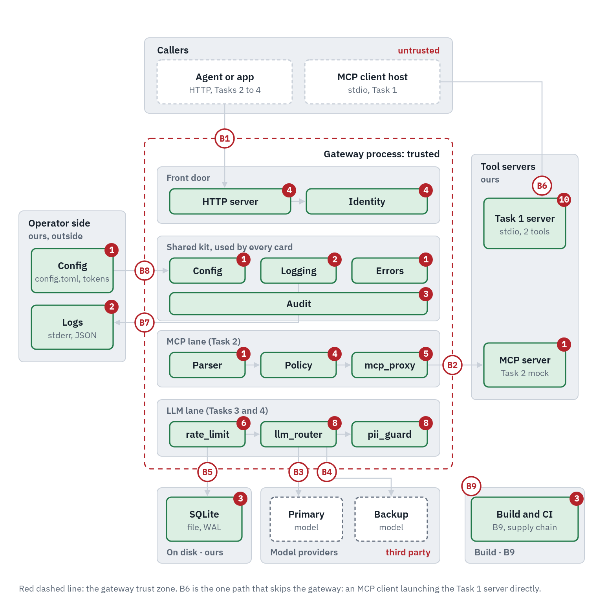

# QuilrAI assessment: MCP server, MCP gateway and LLM gateway

Built for the QuilrAI Solution Architect take-home, November 2026.

Four parts, each runnable on its own:

| Task | What it is | Folder | Status |
| --- | --- | --- | --- |
| 1 | MCP server with strict input validation over stdio | [`task1_mcp_server/`](task1_mcp_server/README.md) | Done |
| 2 | MCP security gateway: bearer token roles, admin tool blocking | [`task2_mcp_gateway/`](task2_mcp_gateway/README.md) | Done |
| 3 | LLM gateway with streaming PII redaction | [`task3_pii_guardrail/`](task3_pii_guardrail/README.md) | Done |
| 4 | Token rate limiter and model failover router | [`task4_rate_limit_failover/`](task4_rate_limit_failover/README.md) | Done |

Targets MCP specification 2026-07-28, and still accepts 2025-11-25 clients.

```
                        ┌──────────────────────────── trusted zone ─────────────────────────────┐
 agent ──stdio────────▶ │ Task 1  MCP server: get_customer_record, trigger_refund               │
                        │                                                                       │
 agent ──HTTP + token─▶ │ Task 2  MCP gateway :8080 ── admin_ tools: admin role only ▶ MCP      │
                        │                                                                       │
 app ────HTTP─────────▶ │ Task 3  LLM gateway :8081 ── PII redacted mid-stream ────▶ provider   │
                        │                                                                       │
 app ────HTTP + token─▶ │ Task 4  LLM router  :8082 ── token budget (SQLite) ──▶ primary/backup │
                        └───────────────────────────────────────────────────────────────────────┘
```

## Threat map



The red dots count the threats tracked on each part, and B1 to B9 mark every place data crosses the trust boundary. The [interactive version](https://rdmilly.github.io/quilr-gateway-assessment/review.html) lets you click any box to see its threats, the defense, the test that proves it and the decision behind it, with the build steps and the full decision log below.

## Where to look first

| Task | The core of it | The test that proves it |
| --- | --- | --- |
| 1 | `task1_mcp_server/schemas.py`, `transport.py` | `tests/task1/test_stdio.py`: the real process, every byte of stdout parsed as JSON-RPC |
| 2 | `task2_mcp_gateway/app.py`, `policy.py` | `tests/task2/test_sdk_client.py`: the official SDK client through the gateway |
| 3 | `task3_pii_guardrail/redactor.py` | `tests/task3/test_redactor.py`: property tests that every way of splitting a stream gives the same result as redacting it whole |
| 4 | `task4_rate_limit_failover/limiter.py`, `router.py` | `tests/task4/test_limiter.py::test_fifty_concurrent_requests_never_overshoot`, `tests/task4/test_processes.py` |

## Proof, in numbers

- 612 tests, 97% branch coverage (the gate fails below 90%), green on Linux (Python 3.12 to 3.14), macOS and Windows.
- Task 3 adds 5 µs median per chunk and sends the first text about 20 ms into an 840 ms stream.
- Task 4: 50 threads racing for one budget get exactly 25 approvals; with the transaction removed the same race approved 88,000 tokens against 50,000. A stalled primary hands over to the backup at 3.05 to 3.08 s over real sockets.
- 0 open code scanning, secret scanning or Dependabot alerts.

## Where this differs from the brief, and why

Each is explained in the task's README and in [decisions](docs/DECISIONS.md).

- **Task 1, invalid arguments** return JSON-RPC `-32602`, as the brief asks. The current MCP spec prefers `isError` tool results for this; switching is one function.
- **Task 2, `-32001`** is used exactly as the brief names it. MCP 2026-07-28 asks new implementations not to use codes from -32000 to -32019. It travels with HTTP 200, because the official SDK client turns any non-2xx reply into a generic error and the code would be lost.
- **Task 4, failover triggers** are the brief's two, 429 and timeout. Failing over on 5xx and connection errors is a setting, off by default.

Beyond the brief, and optional: an idempotency key on `trigger_refund`, and signed JWTs as well as static tokens for the gateways.

Design record: [decisions](docs/DECISIONS.md), [threat model](docs/THREAT-MODEL.md), [build log](docs/BUILD-LOG.md).

## Run the checks

Needs Python 3.12 to 3.14 and [uv](https://docs.astral.sh/uv/). Python 3.15 is excluded for now because pytest and mypy don't run on it yet (November 2026).

```bash
uv sync
./check.sh
```

`check.sh` runs the same gate as CI: lock file check, lint with security rules, formatting, strict types, import rules between tasks, and the tests with coverage. CI adds a dependency audit, a malware check, a workflow scan, a secret scan of the full history, and CodeQL.

## Run each task

Every task reads `config.toml` (copy `config.example.toml`), and each README has commands you can paste:

- Task 1: `uv run python -m task1_mcp_server` ([README](task1_mcp_server/README.md))
- Task 2: [README](task2_mcp_gateway/README.md)
- Task 3: [README](task3_pii_guardrail/README.md)
- Task 4: [README](task4_rate_limit_failover/README.md)

The mocks in `mocks/` stand in for the downstream MCP server and the model providers. Product code never imports them; an import rule in the gate enforces it.

## How this was built

I direct the work and Claude Code writes the code. I set the design, the specs, the constraints and what "done" means for each part, and I review every step before it's committed. I don't hand-write the code, and I'd rather say that up front.

Most of my time goes into context before anything gets built. For this assessment that meant reading the current MCP spec (2026-07-28) and checking every claim against the source instead of trusting what a model remembers. That turned up two places where the brief and the spec disagree, which I raised with your team by email before building. Where I followed the brief anyway, the README says why.

Every change goes through the same gate: lint with security rules, strict typing, import rules that keep the tasks separate, and tests with a 90% branch-coverage floor. On every push, CI also runs on Linux, macOS and Windows, with dependency and malware audits, a secret scan of the full git history, and CodeQL. I check results where they land, not where the tool says they landed. That habit caught a secret scan that was passing while reading 0 bytes, and a failover that fired at 0.5 seconds instead of 3. Both only showed up when I tested real processes rather than trusting green checkmarks.

The work runs on infrastructure I built and run myself: a build controller across my own servers, a record of past failures that gets checked before touching anything that has broken before, and the gate above, which every one of my projects uses.

I don't keep decisions in my head. I write them down with the reasoning and the alternatives I turned down: [decisions](docs/DECISIONS.md), [threat model](docs/THREAT-MODEL.md), [build log](docs/BUILD-LOG.md). That way anyone, including me six months from now, can see why something is the way it is.
